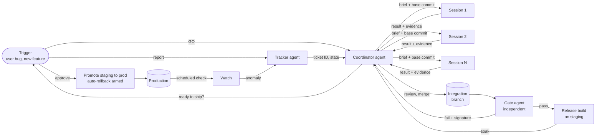
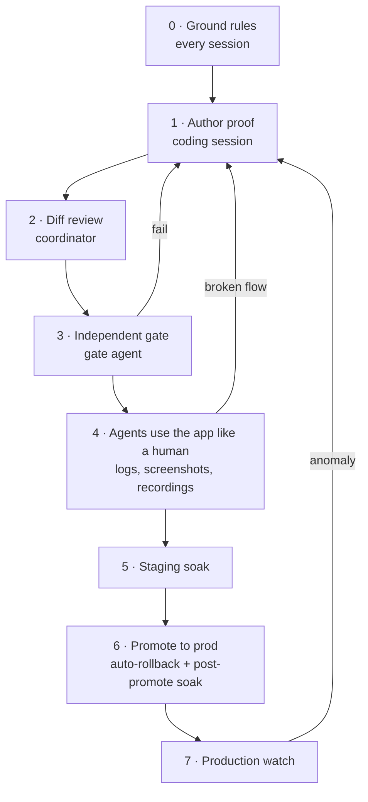

# How to Build a Software Factory

*Build custom verification processes you trust, so you can scale to hundreds of agents and PRs without reading every diff yourself.*

A software factory is a fixed line that turns a trigger (a user bug, a feature request, a production alert) into a verified release. Agents do the triage, the briefs, the coding, the testing and the merging. You show up twice: once to say GO, once to approve the ship.

The point is not how many agents you run. It is building checks you trust enough that the number of agents and PRs stops mattering.

---

## The whole line

Give every role its own long-running agent session with its own memory and inbox. Sessions never share a context window. They hand work to each other through written briefs, git commits and evidence files on disk.

---

## The seven stations

### 1. Intake and triage
**Tracker agent, fast model**

- One agent is the only writer of the bug and feature ledger.
- Every report gets a unique ID, checked against the ledger so duplicates link instead of multiplying.
- Tickets move through fixed states: LOGGED → PROMOTED → SHIPPED → VERIFIED.
- Logging is not dispatching. Nothing gets an owner until a human says go.

*Check: unique ID, owner only after GO.*

### 2. Brief every job
**Coordinator agent, strongest model, high reasoning effort**

Every job is a written brief containing:
- the exact base commit to branch from
- the acceptance checks
- the test that must fail first
- the forbidden moves: weakening assertions, lengthening timeouts, deploying, pushing

When two sessions build two halves of one feature, they agree a written API contract before either writes code. Briefs should arrive through a channel where the session can verify who sent them.

*Check: base commit, fail-first test and forbidden moves named.*

### 3. Fan out
**Coordinator agent launches and supervises the fleet**

- **Parallel by default.** One fresh session per job, each with its own sandbox (or git worktree, if you don't have sandboxes), branch and inbox, so they never collide.
- **Use more than one coding harness.** Put heavy work on your strongest tools, and route cheap, high-volume jobs (mechanical refactors, docs, log summaries, first-pass triage, test scaffolding) to low-cost models. Everything goes through the same gate.
- **Balance by usage.** Before each wave, check how much each plan has been used and place new sessions on the one with headroom.
- **Match model strength to task difficulty** (table below).
- **Supervise automatically.** A scheduled check looks at every session's last activity and wakes any that went quiet without delivering.

| Task type | Model tier | Why |
|----|----|----|
| Coordination, code review, release decisions | Strongest, high effort | Holds the whole system in mind and catches what authors missed |
| Architecture, performance, concurrency, security-sensitive code | Strongest | Subtle bugs here are expensive; depth beats speed |
| Gate runs and failure analysis | Strong reasoning | Must tell a real regression from a flake without loosening the gate |
| UI work, focused fixes, test infrastructure | Strong coding model | Well-specified by the brief; volume matters |
| Mechanical edits, docs, log summaries, first-pass triage | Low-cost models | Cheap and easy to check; the gate still applies |
| Ticket triage and ledger keeping | Fast model | High volume, low ambiguity |

*Check: no session on a saturated plan, no idle session unnoticed.*

### 4. Build against a failing test
**Every coding session, isolated sandbox or worktree**

- Branch from the named commit in a private sandbox, or a git worktree if sandboxes aren't available. Never the live checkout.
- Write the test first and show it fails on the base. Then fix it, then prove it passes.
- Hand back a result package: branch, tip commit, commit list, measured numbers, evidence paths, and a list of what is *not* claimed.

*Check: fails on base, passes on tip, evidence on disk.*

### 5. Review and integrate
**Coordinator agent, one integration branch**

- Read the diff, not just the report: auth on every new route, input and path rules, sandboxing of anything rendered, new dependencies.
- Merge each job as its own commit so any piece can be reverted alone.

*Check: diff read, one revertible merge per job.*

### 6. Gate, staging, ship
**Gate agent, then coordinator**

- A gate agent with a fresh context window, that wrote none of the code, tries to break the change on the exact commit: the fixed core checks plus checks tailored to that change.
- The release is built on staging, set up the same way as production, and soaked.
- The human gets one message: what changed, what passed, "ready to ship?". Approval promotes staging to production with automatic rollback armed.

*Check: gate pass, soak pass, human approval.*

### 7. Watch production
**Coordinator agent, on a schedule**

- Every tick: health and latency, host load, error rate, stalled sessions, work waiting to merge.
- Measure before touching anything: read-only profiles and log sampling, never blind restarts.
- Findings go back to the tracker as new tickets with fail-first tests.

*Check: measure first, change nothing until you know why.*

---

## Verification: seven layers, each run by someone else

Good output comes from the checks, not the prompts. No layer trusts the one before it, and the author never has the final say.

### 0. Ground rules, every session, every turn
- Verify before claiming. If you have not checked with a tool, say so and check.
- State assumptions before non-trivial changes. Make the smallest change that solves the problem.
- Retract immediately when wrong instead of defending the claim.

### 1. Author proof
- **Fail first.** The new test must fail on the base commit, or it proves nothing.
- **Mutation check.** Remove the guard you added and confirm the tests go red.
- **Measure the real output, not a proxy.** If it saves a file, read the bytes back. If it makes sound, measure the waveform. If a UI flickers, capture every frame.
- **Browser matrix.** Desktop and mobile engines, phone and desktop widths, light and dark.
- **Source guards.** Tests that fail if a forbidden pattern appears in the code.
- **Clean measurements only.** Timing numbers count only when the machine is not under load.
- **Isolated fixtures.** Private data directories, fake providers, no live keys, production excluded.

### 2. Diff review
- Read the code, not the summary: auth, input and path rules, sandboxing, new dependencies.
- Confirm the base commit is right and every claim in the result points to a real evidence file.

### 3. Independent gate
Run by an agent that wrote none of the code:
1. **Type-check and release build with outside network blocked**, so the build cannot quietly depend on the internet.
2. **Full unit suite.** Known failures are named in advance. Test files that fail without running a single assertion are counted separately, so a broken import cannot hide.
3. **Every touched browser test file, run whole**, not just the new cases.
4. **Full run on a second machine**, with a secret-leak guard and canary tests that prove the runner itself still detects failure.
5. **Resource soak** on the built artifact: file handles, memory, restarts, shutdown time.

- **Flake protocol.** Rerun any unexpected failure in isolation on the new commit and the old one several times. Fails on both: log it as a flake. Fails only on new: a blocking regression, sent back to the author with its exact signature.
- **Adapts, never loosens.** The gate starts each run with a fresh context, reads the change, and adds targeted attempts to break it on top of the fixed suite. It can add checks. It can never remove or weaken one.
- **Nothing is overwritten.** Failed attempts stay in the evidence. The gate never edits product code, assertions or timeouts.

### 4. Agents use the app like a human
- **Real journeys, not unit paths.** An agent opens the built app at phone and desktop sizes and taps through each changed flow: open, type, send, go back, swipe, rotate, reload, drop the network and come back.
- **Eyes on the logs while it clicks.** Server logs, browser console and network requests are tailed. A flow that looks fine but throws an error or fires a duplicate request still fails.
- **Screenshots at every step**, compared across widths and themes, reviewed for clipped text, overlaps, flashes and blank states.
- **Recordings and frame capture**, so a jumping or see-through frame is caught, not just the end state.
- **Evidence ships with the verdict**, so a human can watch exactly what the agent saw before approving.

### 5. Staging soak
- Build the release in its own worktree and deploy it to staging, configured like production.
- Confirm staging is running the exact build commit, then soak it: steady resources, zero restarts, zero errors.

### 6. Promote staging to production
- Runs only after human approval. Any failed check rolls back to the previous release on its own.
- A short production soak follows, with the previous release kept ready.

### 7. Production watch
- Health, latency, resources and error rate on a schedule.
- Investigation is read-only. Findings become tickets with fail-first tests.

---

## Every job runs the same loop

| Step | How it works |
|----|----|
| Trigger | User bugs and feature requests, plus scheduled production checks |
| Bounded task | Written brief with base commit, fail-first test and forbidden moves |
| Worker | Parallel sessions, one sandbox (or git worktree) each |
| Review | Coordinator reads the diff; an independent gate runs fixed core checks plus change-specific checks on the exact commit |
| Close or escalate | Regression back to the author with its signature, or a logged flake after isolation reruns |
| Human decision | GO to start, approve to ship |

---

## The toolbox (pick your own equivalents)

| Purpose | What you need |
|----|----|
| Isolation | Sandboxes (or git worktrees) per session, one integration branch, revertible merges |
| Tests | A unit test runner, a browser automation tool with mobile emulation, a type checker |
| Human simulation | Agent-driven browsers, step screenshots, screen recordings, live log and network tailing |
| Heavy runs | A second machine as a shared test runner that keeps raw output |
| Coding harnesses | More than one, each session pinned to a model and reasoning effort |
| Coordination | A message bus between agents with sender verification and a way to wake idle sessions |
| Release | Build, deploy-to-staging and promote scripts, a process manager, soak checks |
| Diagnosis | Read-only CPU profiles, open-file sampling, log rate sampling |
| Memory | Per-agent memory files and handoff notes that survive restarts |

---

## Why it works

**No magic prompt. Rules the author cannot skip.**

- **The author never grades their own work.** The gate did not write the code it tests.
- **A test must fail before it counts.** A test that never failed has never proven anything.
- **Gates adapt, but never loosen.** Each change gets its own targeted checks on top of the fixed suite. No weakened assertions, longer timeouts or new allowances to get a pass.
- **Claims carry evidence.** Every number in a report points to a file, and reports list what they did not prove.
- **Parallel, but never shared.** Own sandbox or worktree, branch and context per session. Contracts are written before two sessions touch one interface.
- **Humans decide direction, not mechanics.** People choose what to build and when to ship. Triage, briefs, testing, merging and rollback belong to the line.

---

## What will still break

- **Sleeping sessions miss messages.** Add a scheduled idle check that wakes them.
- **Coordinators make mistakes too.** When one does, turn the fix into a persistent memory rule.
- **Timing-sensitive tests under heavy load.** Root-cause and fix them instead of allowing them forever.
